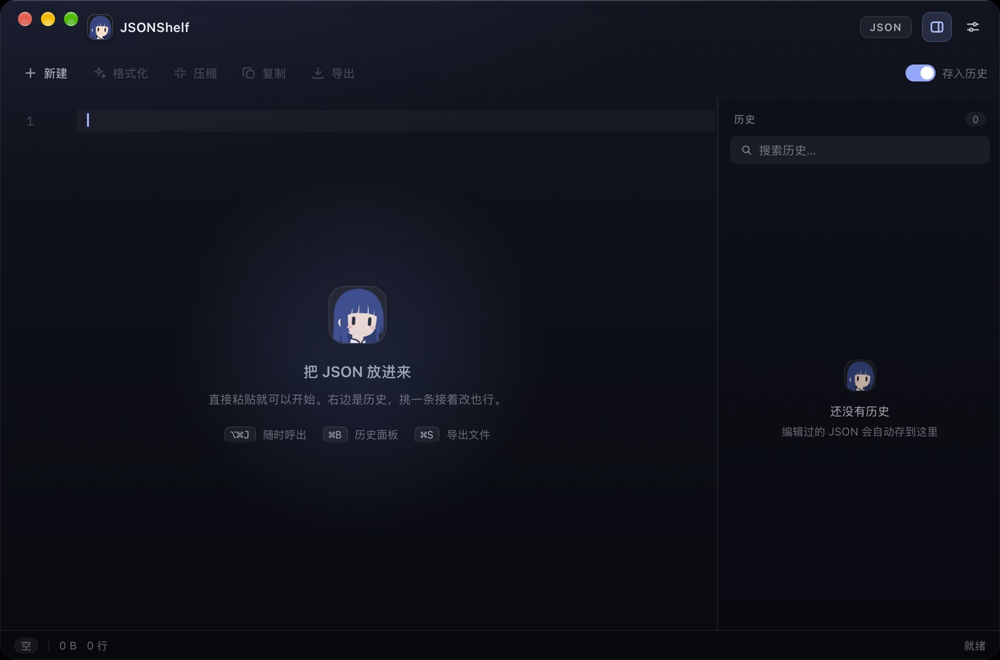

<p align="center">
  
</p>

<h1 align="center">JSONShelf</h1>

<p align="center">
  原生 macOS JSON 工作台<br/>
  <sub>Spotlight 式呼出 · 液态玻璃 · 大文件不卡</sub>
</p>

<p align="center">
  
  
  
  
</p>

<p align="center">
  
</p>

---

## 为什么是 JSONShelf

查一段接口返回、改一条埋点配置、找回上周那份 JSON，这些事不该从"打开一个 IDE"开始。

JSONShelf 把它们收进一个全局快捷键：面板从屏幕边缘出来，粘贴、格式化、改完 `⌘S` 导出。历史自动留底，下次打开还在。所有内容只写本机一个 SQLite 文件，没有账号，也没有云同步。

## 功能

**呼出**
无论当前在哪个 App，按一下快捷键就能把面板叫到前面。窗口被隐藏、最小化，或者上一次被拖到屏幕外，唤出时会重新拉回可见区域。快捷键被别的软件占用时，设置页会直接标出来，不会静默失效。

**编辑**
CodeMirror 6 打底，JSON 语法高亮、代码折叠、实时校验。往空编辑器里粘贴会停在第一行，不会跳到最后。格式化、压缩、复制、导出都在顶部一排。查找、自动换行、minimap 各有自己的开关。

**历史**
编辑停顿后自动存进 SQLite。侧栏只取标题、时间和 240 字预览，正文按需加载，所以历史里堆着几十个大文件也不会拖慢滚动。支持搜索、重命名、固定、删除。每次启动会把数据库另存一份 `.bak`，误写后还能回滚一轮。

**大文件**
超过 400 KB 自动关掉实时校验、自动换行和补全；超过 1 MB 时 React 只保留 4 KB 文件头和行数，正文交给 CodeMirror。实测 9.4 MB、50 万行的 JSON 仍可粘贴、编辑、入库。

**外观**
macOS 26 及以上直接用系统的 `NSGlassEffectView` 做液态玻璃，旧系统回落到 `NSVisualEffectView`，也可以切成纯色。标题栏头像、菜单栏图标和应用图标都来自同一张原图。

**导出**
`⌘S` 走系统保存面板，文件名默认取 JSON 里的标题字段，不用自己敲。

## 安装

目前从源码构建。

需要 Node 18+、pnpm、Rust 工具链，以及 Tauri CLI 2.x。

```bash
cd json-tools
pnpm install
cargo tauri build --bundles app
open src-tauri/target/release/bundle/macos/JSONShelf.app
```

macOS 26 及以上才能看到液态玻璃，旧系统会自动使用毛玻璃。自行分发时需要自己的签名和公证。

## 快捷键

| 动作 | 快捷键 | 动作 | 快捷键 |
|---|---|---|---|
| 呼出 / 收起 | `⌥⌘J` | 格式化 | `⇧⌥F` |
| 导出 | `⌘S` | 新建 | `⌘T` |
| 历史面板 | `⌘B` | 设置 | `⌘,` |
| 查找 | `⌘F` | 隐藏面板 | `esc` |

快捷键都可以在设置里重录；注册失败会显示原因。

## 性能

| 项目 | 数值 |
|---|---|
| `.app` 体积 | 3.9 MB |
| 可执行文件 | 3.6 MB |
| 前端资源 | 672 KB |
| 主进程物理内存 | ~39 MB |
| 9.4 MB / 50 万行 JSON | 可粘贴、编辑、入库 |

包体来自 Rust release 配置（`opt-level="z"`、LTO、`codegen-units=1`、`strip`、`panic="abort"`），前端只保留 JSON 需要的依赖，图标量化到 256 色。内存侧的关键是列表只查元数据、正文按需取；大文件在 React 里只留文件头，不再复制一份全文。

WebKit 的 WebContent / GPU 进程要另外算。9.4 MB 文件保存的瞬间会冲高，落盘后回落。

## 架构

```
src-tauri/src/
├── shortcut.rs   全局快捷键注册、重绑、状态
├── window.rs     唤出 / 激活 / 越界修复
├── glass.rs      NSGlassEffectView 与毛玻璃回落
├── tray.rs       菜单栏图标与菜单
└── lib.rs        迁移、导出、设置命令
src/
├── components/   TitleBar / Toolbar / EditorPane / HistoryPanel / SettingsPanel
└── lib/          ipc / history / formatter / hotkeys
```

- **存储**：`tauri-plugin-sql` + SQLite，WAL 模式。列表查询只读 id、标题、时间和预览；正文懒加载。写入前校验"正文归属条目"，避免切换条目时写串；启动时备份数据库。
- **编辑器**：CodeMirror 6，行数直接取 `doc.lines`，不再 `split` 全文；粘贴到空文档时把选区锚回开头。
- **窗口**：唤出前检查 `NSApp.isActive()` 和 keyWindow，必要时 `orderFrontRegardless` 加 `activate`；窗口不完全落在任一显示器工作区时重新居中。
- **玻璃**：运行时插入 `NSGlassEffectView`（macOS 26+），失败回落 `NSVisualEffectView`；CSS 只负责内容和高光。
- **图标**：一张原图同时生成应用图标、菜单栏模板图和 App 内头像；菜单栏用 36px 模板，跟随明暗自动反色。

## 开发

```bash
pnpm install
pnpm test        # 94 个用例
cargo tauri dev  # 开发模式
```

重新生成图标（需要 Pillow 和 numpy）：

```bash
python3 scripts/generate-icons.py
```

## 隐私

所有历史只存在 `~/Library/Application Support/com.jsonshelf.app/jsonshelf.db`，启动时另存一份 `.bak`。没有网络请求，没有遥测，也没有账号。

## 已知限制

- 只处理 JSON。多语言格式化和 Prettier 已经移除，换来更小的包体和更少的运行时依赖。
- 超过 400 KB 不做实时校验、自动换行和补全，状态栏会显示"未校验"。
- 超大文件保存的瞬时内存由 WebKit 决定，9.4 MB 时峰值会到几百 MB，落盘后回落。
- 菜单栏图标可能被 Bartender、Hidden Bar 之类的工具折进二级菜单。
- 全局快捷键被占用时不会静默失败，但需要你在设置里换一个组合。

## 许可

私有项目，未授权。
